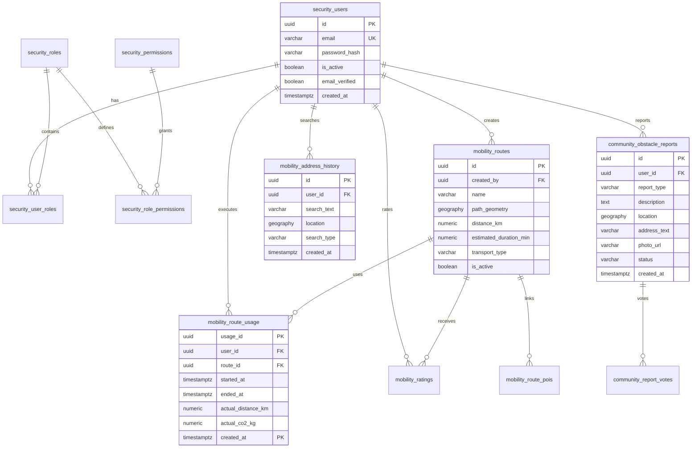

# 🗄️ EcoRuteandoDb — Base de Datos y Migraciones Liquibase

Repositorio oficial del esquema relacional y espacial de **EcoRuteando**, implementado sobre **PostgreSQL 16** con la extensión geoespacial **PostGIS 3.5** y versionado declarativo con **Liquibase**.

---

## 🏛️ Esquemas y Módulos del Dominio

La base de datos está organizada en esquemas modulares que representan los contextos delimitados del sistema:

1. **`security`**: Gestión de usuarios, credenciales hasheadas con BCrypt (cost factor 12), roles, permisos atómicos granulares, sesiones y tokens 2FA.
2. **`mobility`**: Rutas ecológicas, puntos geográficos (SRID 4326), waypoints, historial de navegación (`route_usage` particionada), direcciones frecuentes (`address_history`) y calificaciones (`ratings`).
3. **`community`**: Reportes ciudadanos de obstáculos viales (`obstacle_reports`), evidencias fotográficas y votación comunitaria de confiabilidad.
4. **`admin`**: Parámetros globales del sistema, factores de emisión de transporte (`transport_factors`), tickets de soporte, auditoría y el **módulo B2B SaaS de sostenibilidad corporativa y flotas**:
   - `admin.companies`: Organizaciones y empresas de transporte habilitadas (ej. Coomotor, Cootranshuila) con cuotas mensuales de emisiones y estado de habilitación.
   - `admin.company_fleet_types`: Tipos vehiculares de flota por empresa con sus factores de emisión por km y conteo de vehículos.
   - `admin.carbon_compensations`: Registros inmutables de compensación voluntaria de emisiones, con equivalencia biológica certificada en árboles nativos plantados y código de verificación para auditoría ambiental.
5. **`notifications`**: Canales de notificación por usuario y plantillas.

---

## 🗺️ Diagrama Entidad-Relación (ERD)



---

## 🚀 Despliegue Local con Docker

### Prerrequisitos
- Docker Engine >= 24.x y Docker Compose v2

### 1. Iniciar la Base de Datos
Desde el repositorio principal o con Docker Compose:

```bash
docker run -d \
  --name ecoruteando-postgres \
  -e POSTGRES_DB=ecoRuteando_db \
  -e POSTGRES_USER=postgres \
  -e POSTGRES_PASSWORD=postgres \
  -p 5432:5432 \
  postgis/postgis:16-3.5
```

### 2. Aplicar Migraciones Liquibase
Ejecutar el contenedor de Liquibase para aplicar todas las migraciones en orden:

```bash
docker run --rm \
  --network host \
  -v $(pwd):/liquibase/changelog \
  liquibase/liquibase:4.29-alpine \
  --changelog-file=changelog/db.changelog-master.yaml \
  --url=jdbc:postgresql://localhost:5432/ecoRuteando_db \
  --username=postgres \
  --password=postgres \
  update
```

---

## 🔄 Validación de Rollback

Todas las migraciones cuentan con scripts de reversión idempotentes verificados en CI:

```bash
# Validar rollback de las últimas migraciones
docker run --rm \
  --network host \
  -v $(pwd):/liquibase/changelog \
  liquibase/liquibase:4.29-alpine \
  --changelog-file=changelog/db.changelog-master.yaml \
  --url=jdbc:postgresql://localhost:5432/ecoRuteando_db \
  --username=postgres \
  --password=postgres \
  rollbackCount 1
```

---

## 🧪 Pruebas Automatizadas de Integridad

El pipeline de CI valida:
1. Creación de esquemas y tablas con tipos PostGIS.
2. Restricciones de integridad referencial (Foreign Keys y Checks).
3. Inserción de semillas maestras de permisos y roles del sistema.
4. Ejecución completa del changelog, rollback controlado y reaplicación limpia.
